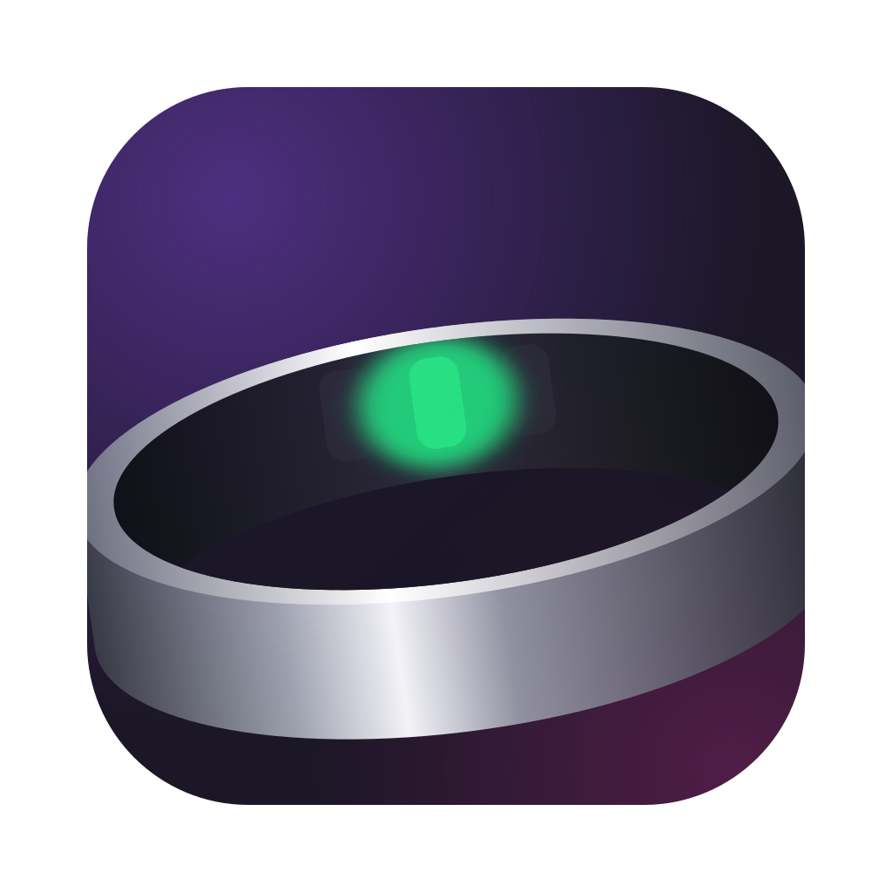
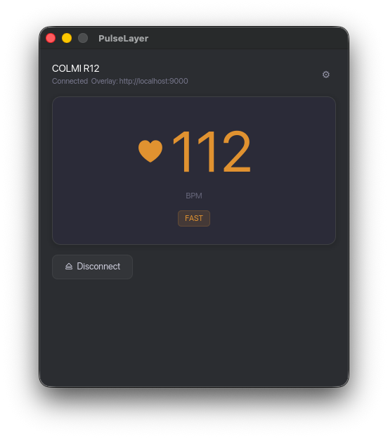
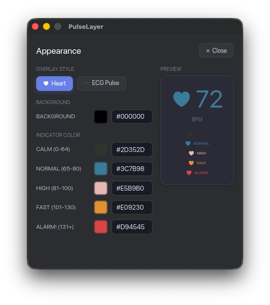
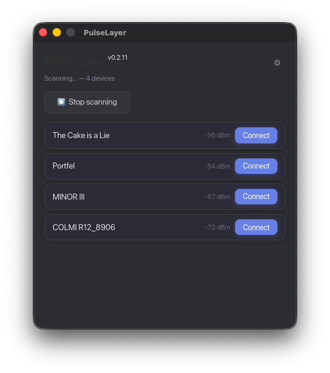
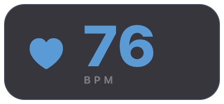
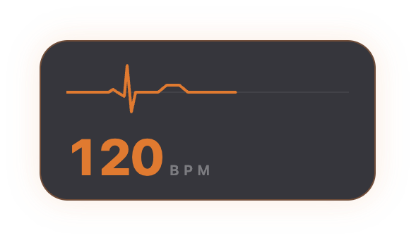

<h1 align="center">PulseLayer</h1>

<p align="center">
  <a href="https://github.com/wielorzeczownik/pulse-layer/actions/workflows/release.yml"><picture><source media="(prefers-color-scheme: dark)" srcset="https://img.shields.io/github/actions/workflow/status/wielorzeczownik/pulse-layer/release.yml?branch=main&style=flat-square&labelColor=2d333b&color=3fb950"/><source media="(prefers-color-scheme: light)" srcset="https://img.shields.io/github/actions/workflow/status/wielorzeczownik/pulse-layer/release.yml?branch=main&style=flat-square&color=2ea043"/></picture></a> <a href="https://github.com/wielorzeczownik/pulse-layer/releases/latest"><picture><source media="(prefers-color-scheme: dark)" srcset="https://img.shields.io/github/v/release/wielorzeczownik/pulse-layer?style=flat-square&labelColor=2d333b&color=3fb950"/><source media="(prefers-color-scheme: light)" srcset="https://img.shields.io/github/v/release/wielorzeczownik/pulse-layer?style=flat-square&color=2ea043"/></picture></a> <a href="https://github.com/wielorzeczownik/pulse-layer/blob/main/LICENSE"><picture><source media="(prefers-color-scheme: dark)" srcset="https://img.shields.io/badge/License-MIT-3fb950?style=flat-square&labelColor=2d333b"/><source media="(prefers-color-scheme: light)" srcset="https://img.shields.io/badge/License-MIT-2ea043?style=flat-square"/></picture></a>
  <br/>
  
  
  
</p>

<p align="center">
  
</p>

<p align="center">🇬🇧 English | 🇵🇱 <a href="README.pl.md">Polski</a></p>

A heart rate overlay for [OBS Studio](https://obsproject.com), fed by a Bluetooth smart ring.

It goes into OBS as a browser source. Everything runs locally, with no cloud and no accounts.

Originally made for [KitsuneTsuyu](https://www.twitch.tv/kitsunetsuyu).

<div align="center">
<table>
<tr>
<td align="center" width="33%"><br/><sub><b>Live BPM</b></sub></td>
<td align="center" width="33%"><br/><sub><b>Settings</b></sub></td>
<td align="center" width="33%"><br/><sub><b>Scan</b></sub></td>
</tr>
</table>
</div>

## Supported rings

Tested on the COLMI R12. Rings that use the Qring app should work too, since they speak the same BLE protocol. Other brands aren't supported. If enough people ask, I might add them.

## Download

Grab the file for your system from [Releases](https://github.com/wielorzeczownik/pulse-layer/releases/latest).

| System  | Installer                                                                                                                                                                                                                                                                                                                                                                              | Portable                                                                                                                                                                                                                                                                                                                                                             |
| ------- | -------------------------------------------------------------------------------------------------------------------------------------------------------------------------------------------------------------------------------------------------------------------------------------------------------------------------------------------------------------------------------------- | -------------------------------------------------------------------------------------------------------------------------------------------------------------------------------------------------------------------------------------------------------------------------------------------------------------------------------------------------------------------- |
| Windows | [x64](https://github.com/wielorzeczownik/pulse-layer/releases/latest/download/pulse-layer-x86_64-pc-windows-msvc-setup.exe), [ARM64](https://github.com/wielorzeczownik/pulse-layer/releases/latest/download/pulse-layer-aarch64-pc-windows-msvc-setup.exe), [x86](https://github.com/wielorzeczownik/pulse-layer/releases/latest/download/pulse-layer-i686-pc-windows-msvc-setup.exe) | [x64](https://github.com/wielorzeczownik/pulse-layer/releases/latest/download/pulse-layer-x86_64-pc-windows-msvc.zip), [ARM64](https://github.com/wielorzeczownik/pulse-layer/releases/latest/download/pulse-layer-aarch64-pc-windows-msvc.zip), [x86](https://github.com/wielorzeczownik/pulse-layer/releases/latest/download/pulse-layer-i686-pc-windows-msvc.zip) |
| macOS   | [.dmg](https://github.com/wielorzeczownik/pulse-layer/releases/latest/download/pulse-layer-universal-apple-darwin.dmg) (Intel and Apple Silicon)                                                                                                                                                                                                                                       | [.tar.gz](https://github.com/wielorzeczownik/pulse-layer/releases/latest/download/pulse-layer-universal-apple-darwin.tar.gz)                                                                                                                                                                                                                                         |
| Linux   | [.deb](https://github.com/wielorzeczownik/pulse-layer/releases/latest/download/pulse-layer-x86_64-unknown-linux-gnu.deb), [.AppImage](https://github.com/wielorzeczownik/pulse-layer/releases/latest/download/pulse-layer-x86_64-unknown-linux-gnu.AppImage)                                                                                                                           | [.tar.gz](https://github.com/wielorzeczownik/pulse-layer/releases/latest/download/pulse-layer-x86_64-unknown-linux-gnu.tar.gz)                                                                                                                                                                                                                                       |

### Windows

The installer isn't signed, so SmartScreen will complain about an unknown publisher. Click **More info**, then **Run anyway**.

### macOS

The app isn't signed with a paid Apple certificate, so macOS blocks the first launch. Right-click the app and pick **Open**, or run this once:

```bash
xattr -cr /Applications/PulseLayer.app
```

## Connecting the ring

Charge the ring, open PulseLayer, click **Scan for rings** and then **Connect** next to your ring.

The ring talks to one device at a time. If it's connected to the Qring app on your phone, PulseLayer won't find it, so turn off Bluetooth on the phone first.

To go back to the phone later, the ring has to be forgotten on both sides:

1. Click **Disconnect** in PulseLayer.
2. Remove the ring in your computer's Bluetooth settings.
3. Remove it on the phone too.
4. Pair it again in the Qring app.

> [!IMPORTANT]
> If you skip step 2 or 3, pairing on the phone will fail.

## OBS

PulseLayer serves the overlay at `http://localhost:9000` as long as the app is open.

1. In OBS, add a new **Browser** source.
2. Set the URL to `http://localhost:9000`, width `400` and height `300`.
3. Optionally tick **Refresh browser when scene becomes active**.

The widget sits in the bottom-left corner of the source, so crop the source and move it wherever you want. If you restart PulseLayer, the overlay reconnects by itself.

## Overlay styles

You switch the style in the **Appearance** panel. **Heart** is a beating heart with the BPM next to it. **ECG Pulse** draws a line once per beat with the BPM below.

<div align="center">
<table>
<tr>
<td align="center" width="50%"><br/><sub><b>Heart</b></sub></td>
<td align="center" width="50%"><br/><sub><b>ECG</b></sub></td>
</tr>
</table>
</div>

The color changes with the BPM zone. You can change every color in the **Appearance** panel.

| Zone   | BPM     | Default color |
| ------ | ------- | ------------- |
| Calm   | 0-64    | green         |
| Normal | 65-80   | blue          |
| High   | 81-100  | yellow        |
| Fast   | 101-130 | orange        |
| Alarm  | 131+    | red           |

## Settings file

There are no command-line flags or environment variables. Settings are saved to `settings.json`:

| System  | Path                                                     |
| ------- | -------------------------------------------------------- |
| Windows | `%APPDATA%\pulselayer\settings.json`                     |
| macOS   | `~/Library/Application Support/pulselayer/settings.json` |
| Linux   | `~/.config/pulselayer/settings.json`                     |

<details>
<summary>All keys</summary>

| Key               | Default   | Meaning                                  |
| ----------------- | --------- | ---------------------------------------- |
| `zone_calm_hex`   | `#52C27A` | calm zone color                          |
| `zone_normal_hex` | `#5B9BD5` | normal zone color                        |
| `zone_high_hex`   | `#E5B950` | high zone color                          |
| `zone_fast_hex`   | `#E07A30` | fast zone color                          |
| `zone_alarm_hex`  | `#D94545` | alarm zone color                         |
| `panel_bg_hex`    | `#0A0A12` | overlay background, drawn at 82% opacity |
| `overlay_style`   | `"Heart"` | `"Heart"` or `"Pulse"` (the ECG line)    |

If any key is missing or the JSON is broken, the whole file is ignored and everything goes back to defaults. A color that isn't six hex digits shows up grey.

</details>

The port is always `9000` and can't be changed.

## Building from source

You need [Rust](https://rustup.rs) stable and [Node.js](https://nodejs.org) 24+.

```bash
git clone https://github.com/wielorzeczownik/pulse-layer
cd pulse-layer
cargo build --release
```

`cargo build` builds the overlay with Vite too and embeds it in the binary.

On Linux you also need:

```bash
sudo apt-get install libdbus-1-dev pkg-config libxkbcommon-dev \
  libxcb-shape0-dev libxcb-xfixes0-dev libwayland-dev
```

On macOS, `./run_macos.sh` builds a debug `.app`, signs it ad-hoc and opens it. It needs [cargo-packager](https://github.com/crabnebula-dev/cargo-packager) (`cargo install cargo-packager --locked`).

## Disclaimer

Not official and not affiliated with COLMI or any other ring maker. If a ring firmware update changes the BLE protocol, PulseLayer may stop working.
