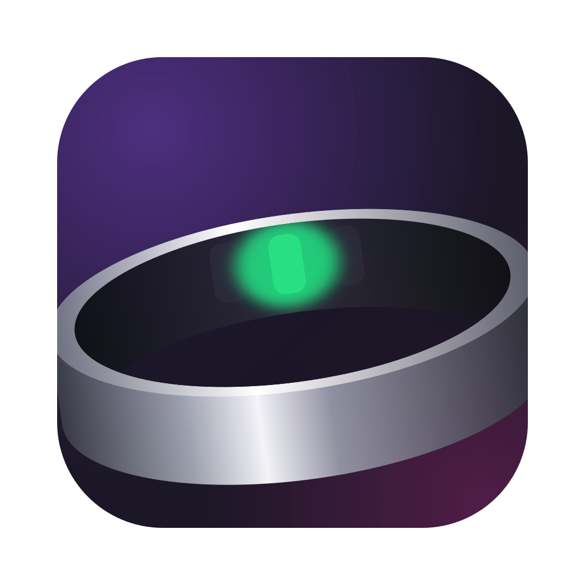
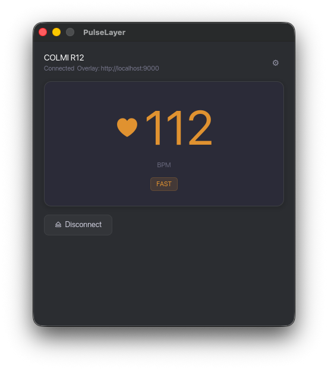
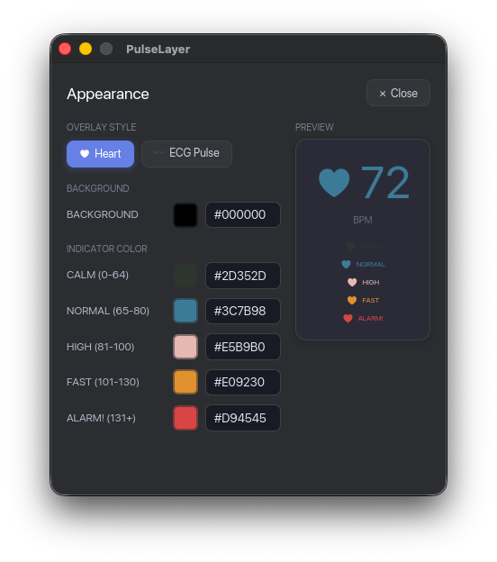
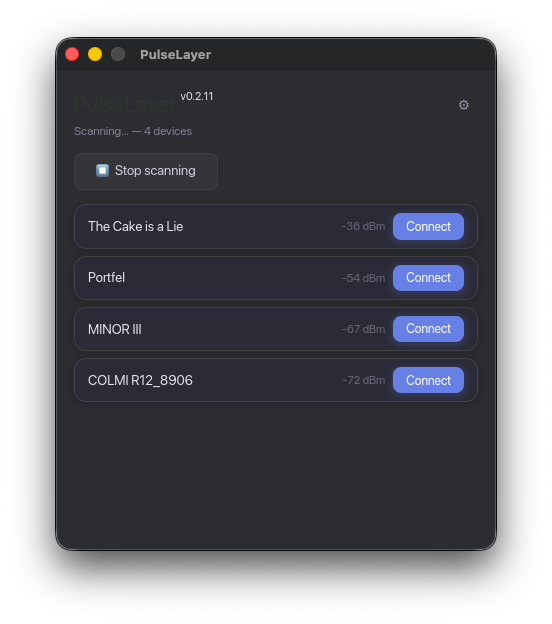
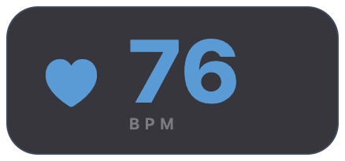
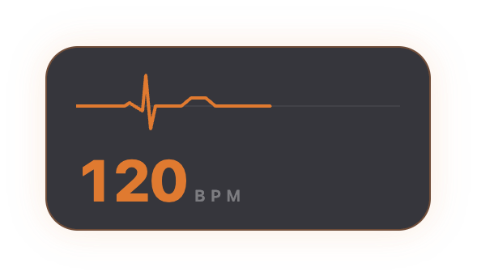

<h1 align="center">PulseLayer</h1>

<p align="center">
  <a href="https://github.com/wielorzeczownik/pulse-layer/actions/workflows/release.yml"><picture><source media="(prefers-color-scheme: dark)" srcset="https://img.shields.io/github/actions/workflow/status/wielorzeczownik/pulse-layer/release.yml?branch=main&style=flat-square&labelColor=2d333b&color=3fb950"/><source media="(prefers-color-scheme: light)" srcset="https://img.shields.io/github/actions/workflow/status/wielorzeczownik/pulse-layer/release.yml?branch=main&style=flat-square&color=2ea043"/></picture></a> <a href="https://github.com/wielorzeczownik/pulse-layer/releases/latest"><picture><source media="(prefers-color-scheme: dark)" srcset="https://img.shields.io/github/v/release/wielorzeczownik/pulse-layer?style=flat-square&labelColor=2d333b&color=3fb950"/><source media="(prefers-color-scheme: light)" srcset="https://img.shields.io/github/v/release/wielorzeczownik/pulse-layer?style=flat-square&color=2ea043"/></picture></a> <a href="https://github.com/wielorzeczownik/pulse-layer/blob/main/LICENSE"><picture><source media="(prefers-color-scheme: dark)" srcset="https://img.shields.io/badge/License-MIT-3fb950?style=flat-square&labelColor=2d333b"/><source media="(prefers-color-scheme: light)" srcset="https://img.shields.io/badge/License-MIT-2ea043?style=flat-square"/></picture></a>
  <br/>
  
  
  
</p>

<p align="center">
  
</p>

<p align="center">🇬🇧 <a href="README.md">English</a> | 🇵🇱 Polski</p>

Nakładka do [OBS Studio](https://obsproject.com) z tętnem odczytywanym z pierścienia Bluetooth.

W OBS dodaje się ją jako źródło przeglądarki. Wszystko działa lokalnie, bez chmury i kont.

Pierwotnie powstała dla [KitsuneTsuyu](https://www.twitch.tv/kitsunetsuyu).

<div align="center">
<table>
<tr>
<td align="center" width="33%"><br/><sub><b>BPM na żywo</b></sub></td>
<td align="center" width="33%"><br/><sub><b>Ustawienia</b></sub></td>
<td align="center" width="33%"><br/><sub><b>Skanowanie</b></sub></td>
</tr>
</table>
</div>

## Obsługiwane pierścienie

Testowane na COLMI R12. Pierścienie z aplikacji Qring też powinny działać, bo mają ten sam protokół BLE. Innych marek nie ma. Jak będzie dużo chętnych, może dodam.

## Pobieranie

Pobierz plik dla swojego systemu z [Releases](https://github.com/wielorzeczownik/pulse-layer/releases/latest).

| System  | Instalator                                                                                                                                                                                                                                                                                                                                                                             | Bez instalacji                                                                                                                                                                                                                                                                                                                                                       |
| ------- | -------------------------------------------------------------------------------------------------------------------------------------------------------------------------------------------------------------------------------------------------------------------------------------------------------------------------------------------------------------------------------------- | -------------------------------------------------------------------------------------------------------------------------------------------------------------------------------------------------------------------------------------------------------------------------------------------------------------------------------------------------------------------- |
| Windows | [x64](https://github.com/wielorzeczownik/pulse-layer/releases/latest/download/pulse-layer-x86_64-pc-windows-msvc-setup.exe), [ARM64](https://github.com/wielorzeczownik/pulse-layer/releases/latest/download/pulse-layer-aarch64-pc-windows-msvc-setup.exe), [x86](https://github.com/wielorzeczownik/pulse-layer/releases/latest/download/pulse-layer-i686-pc-windows-msvc-setup.exe) | [x64](https://github.com/wielorzeczownik/pulse-layer/releases/latest/download/pulse-layer-x86_64-pc-windows-msvc.zip), [ARM64](https://github.com/wielorzeczownik/pulse-layer/releases/latest/download/pulse-layer-aarch64-pc-windows-msvc.zip), [x86](https://github.com/wielorzeczownik/pulse-layer/releases/latest/download/pulse-layer-i686-pc-windows-msvc.zip) |
| macOS   | [.dmg](https://github.com/wielorzeczownik/pulse-layer/releases/latest/download/pulse-layer-universal-apple-darwin.dmg) (Intel i Apple Silicon)                                                                                                                                                                                                                                         | [.tar.gz](https://github.com/wielorzeczownik/pulse-layer/releases/latest/download/pulse-layer-universal-apple-darwin.tar.gz)                                                                                                                                                                                                                                         |
| Linux   | [.deb](https://github.com/wielorzeczownik/pulse-layer/releases/latest/download/pulse-layer-x86_64-unknown-linux-gnu.deb), [.AppImage](https://github.com/wielorzeczownik/pulse-layer/releases/latest/download/pulse-layer-x86_64-unknown-linux-gnu.AppImage)                                                                                                                           | [.tar.gz](https://github.com/wielorzeczownik/pulse-layer/releases/latest/download/pulse-layer-x86_64-unknown-linux-gnu.tar.gz)                                                                                                                                                                                                                                       |

### Windows

Instalator nie jest podpisany, więc SmartScreen ostrzeże o nieznanym wydawcy. Kliknij **Więcej informacji**, potem **Uruchom mimo to**.

### macOS

Aplikacja nie ma płatnego certyfikatu Apple, więc macOS zablokuje pierwsze uruchomienie. Kliknij ją prawym przyciskiem i wybierz **Otwórz** albo odpal raz:

```bash
xattr -cr /Applications/PulseLayer.app
```

## Łączenie z pierścieniem

Naładuj pierścień, otwórz PulseLayer, kliknij **Skanuj pierścienie**, a potem **Połącz** przy swoim pierścieniu.

Pierścień gada naraz tylko z jednym urządzeniem. Jeśli jest połączony z aplikacją Qring na telefonie, PulseLayer go nie znajdzie, więc najpierw wyłącz Bluetooth w telefonie.

Żeby potem wrócić do telefonu, pierścień trzeba zapomnieć po obu stronach:

1. Kliknij **Rozłącz** w PulseLayer.
2. Usuń pierścień w ustawieniach Bluetooth komputera.
3. Usuń go też w telefonie.
4. Sparuj go od nowa w aplikacji Qring.

> [!IMPORTANT]
> Bez kroku 2 lub 3 parowanie na telefonie się nie uda.

## OBS

Dopóki PulseLayer jest otwarty, nakładka jest pod `http://localhost:9000`.

1. W OBS dodaj nowe źródło **Przeglądarka**.
2. Ustaw URL na `http://localhost:9000`, szerokość `400` i wysokość `300`.
3. Opcjonalnie zaznacz **Odśwież przeglądarkę, gdy scena staje się aktywna**.

Widget siedzi w lewym dolnym rogu źródła, więc przytnij źródło i przesuń je gdzie chcesz. Po restarcie PulseLayer nakładka połączy się sama.

## Style nakładki

Styl zmienia się w panelu **Wygląd** w PulseLayer. **Serce** to bijące serce z BPM obok. **Linia EKG** rysuje się raz na uderzenie, z BPM pod spodem.

<div align="center">
<table>
<tr>
<td align="center" width="50%"><br/><sub><b>Serce</b></sub></td>
<td align="center" width="50%"><br/><sub><b>Linia EKG</b></sub></td>
</tr>
</table>
</div>

Kolor zależy od poziomu tętna. Każdy kolor da się zmienić w panelu **Wygląd**.

| Poziom      | BPM     | Domyślny kolor |
| ----------- | ------- | -------------- |
| Spokojny    | 0-64    | zielony        |
| Umiarkowany | 65-80   | niebieski      |
| Podwyższony | 81-100  | żółty          |
| Intensywny  | 101-130 | pomarańczowy   |
| Ekstremalny | 131+    | czerwony       |

## Plik ustawień

Nie ma flag wiersza poleceń ani zmiennych środowiskowych. Ustawienia lądują w `settings.json`:

| System  | Ścieżka                                                  |
| ------- | -------------------------------------------------------- |
| Windows | `%APPDATA%\pulselayer\settings.json`                     |
| macOS   | `~/Library/Application Support/pulselayer/settings.json` |
| Linux   | `~/.config/pulselayer/settings.json`                     |

<details>
<summary>Wszystkie klucze</summary>

| Klucz             | Domyślnie | Znaczenie                            |
| ----------------- | --------- | ------------------------------------ |
| `zone_calm_hex`   | `#52C27A` | kolor poziomu Spokojny               |
| `zone_normal_hex` | `#5B9BD5` | kolor poziomu Umiarkowany            |
| `zone_high_hex`   | `#E5B950` | kolor poziomu Podwyższony            |
| `zone_fast_hex`   | `#E07A30` | kolor poziomu Intensywny             |
| `zone_alarm_hex`  | `#D94545` | kolor poziomu Ekstremalny            |
| `panel_bg_hex`    | `#0A0A12` | tło nakładki, rysowane z kryciem 82% |
| `overlay_style`   | `"Heart"` | `"Heart"` albo `"Pulse"` (linia EKG) |

Jeśli brakuje któregoś klucza albo JSON jest zepsuty, cały plik jest ignorowany i wszystko wraca do domyślnych. Kolor, który nie jest sześcioma cyframi hex, wyświetli się na szaro.

</details>

Port to zawsze `9000` i nie da się go zmienić.

## Budowanie ze źródeł

Potrzebujesz [Rusta](https://rustup.rs) stable i [Node.js](https://nodejs.org) 24+.

```bash
git clone https://github.com/wielorzeczownik/pulse-layer
cd pulse-layer
cargo build --release
```

`cargo build` buduje też nakładkę przez Vite i wkleja ją do binarki.

Na Linuxie potrzebujesz jeszcze:

```bash
sudo apt-get install libdbus-1-dev pkg-config libxkbcommon-dev \
  libxcb-shape0-dev libxcb-xfixes0-dev libwayland-dev
```

Na macOS `./run_macos.sh` buduje debugowe `.app`, podpisuje je ad-hoc i otwiera. Wymaga [cargo-packager](https://github.com/crabnebula-dev/cargo-packager) (`cargo install cargo-packager --locked`).

## Zastrzeżenie

Projekt nieoficjalny, niezwiązany z COLMI ani innym producentem pierścieni. Jeśli aktualizacja firmware pierścienia zmieni protokół BLE, PulseLayer może przestać działać.
